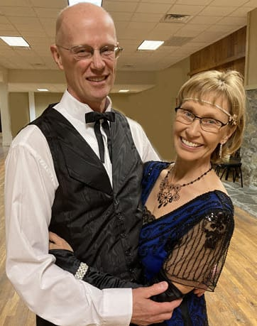

# Featured Staff

The festival's featured caller, cuers, and clogging instructor. See the
Staff Schedule page for when to find each of them.

## Ted Lizotte — Featured Caller

Ted Lizotte and his wife Shelly make their home in Manchester, New
Hampshire. Ted learned to square dance in 1988 and began calling that same
year. He started teaching classes in 1990 and has taught beginner classes
every year since. In 1997, Ted was asked to be the club caller for Tech
Squares of MIT and is still teaching their 12-week Crash Course today.

In 2017 Ted started his own music label and is the owner/producer of Throw
Back Tunes. He also co-owns/produces TOTL Recordings with Tony Oxendine. Ted
has also been featured on recordings for Arrowhead, Chic, EGO Recordings,
and Royal Records.

Ted has been a member of CALLERLAB since 1991. In early 2020, he earned his
Accredited Caller Coach designation from CALLERLAB, the 38th caller to earn
the distinction. Ted has served on its Board of Governors since 2018, was
elected to the Executive Committee of CALLERLAB in 2021 and as of April 2023
is CALLERLAB's Chairman of the Board, completing his tenure in April of
2026.

Ted has been featured at numerous festivals and weekends both nationally and
internationally and is well known for his smooth flowing choreography and
music usage. He currently calls beginners through C1.

## Pamela & Jeff Johnson — Featured Round Dance Cuers

Pamela and Jeff Johnson are choreographed ballroom dancers and instructors
of Rapid Ballroom, which they founded in 2014. Each hailing from an artistic
stock, they bring not only a background in dance and teaching but an
undeniable love and insight to their classes which allows students to
progress comfortably and rapidly.

At a young age Pamela began taking lessons in ballet and tap. Later on she
added modern, jazz and clogging to her studies. For many years she taught
dance at the Myles Reif Performing Arts Center in Grand Rapids, Minnesota.
Jeff's parents were beautiful dancers who cultivated a love for dance in
their children. Many nights, back on the farm in northern Minnesota, you
could find the Johnsons rolling back the living room rug and dancing to the
Lawrence Welk show.

Jeff and Pamela have taken private ballroom lessons with Paul Botes of
American Classic Ballroom and Rea Lyons of Superior Ballroom. Their most
recent choreography includes "Snowfall", "Don't Ever", "Hey Daddy Cha",
"Mariposa", "You've Got a Friend", "Rock Boppin Baby", "Nothing At All",
"Jumpin' The Jetty" and "Better Place". They are members of Roundalab, ICBDA
(Former BOD), Round Dance Council of Florida and Minnesota Round Dance
Council. Jeff and Pamela have taught across the US and in Europe at Cham,
ECTA and the Europe Round Dance Fest in Karlskrona, Sweden.

After retiring from teaching school in northern Minnesota, Pamela and Jeff
began spending the winters in central Florida. They now teach, beginners
through phase 6, at the Stardust Dance Center in Plant City, under the
direction of Curt and Tammy Worlock. They continue to teach their classes in
Minnesota during the spring and fall months.

Pamela and Jeff would like to send out a personal invitation to each of you
to join them on the dance floor.

## Trevor DeWitt — Featured Clogging Instructor

Trevor DeWitt has been clogging since the age of seven, beginning his dance
journey in Louisville, Kentucky. He started with the Riverside Cloggers in
New Albany, Indiana, where his passion for the art form quickly grew. Trevor
soon rose to become the group's instructor, sparking a lifelong commitment
to teaching and sharing clogging with others.

He taught his first clogging workshop in 2000, and for more than two decades
has traveled the world as a respected instructor. Trevor has taught at
national clogging conventions in the USA, Canada, and Australia, teaching
thousands of dancers and spreading his trademark energy and enthusiasm.
Known in the clogging community as the "King of the Fun Dance," Trevor is
celebrated for his lively choreography and the ability to make every class
feel like a party on the dance floor.

Beyond the stage and studio, Trevor is the creator and operator of
[clogdancing.com](https://clogdancing.com), a community hub for cloggers
worldwide, with directories of clogging instructors, teams, studios, vendors
and organizations; an events calendar of local, national, and international
workshops and conventions; and a cue sheet library.

Trevor currently instructs the Kentuckiana Cloggers and the Southern Indiana
Cloggers, where he continues to mentor dancers, create innovative routines,
and keep the joy of clogging alive.
