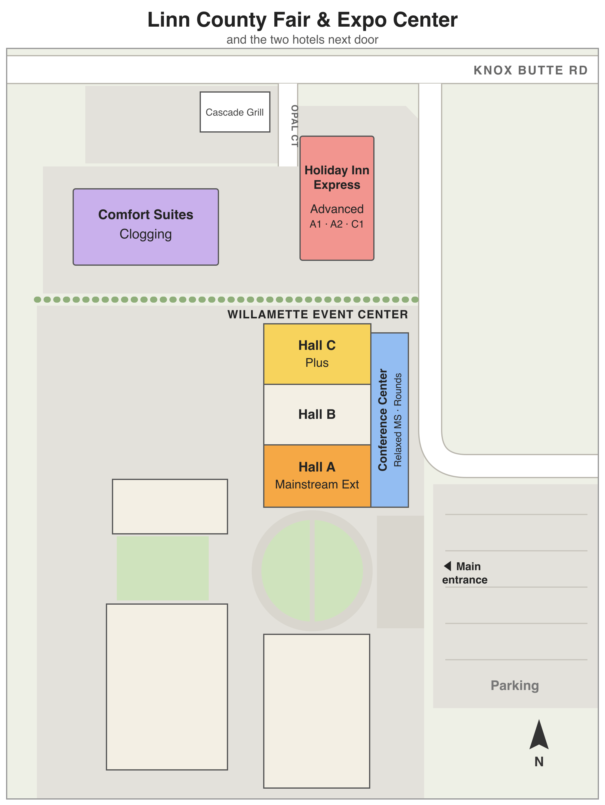
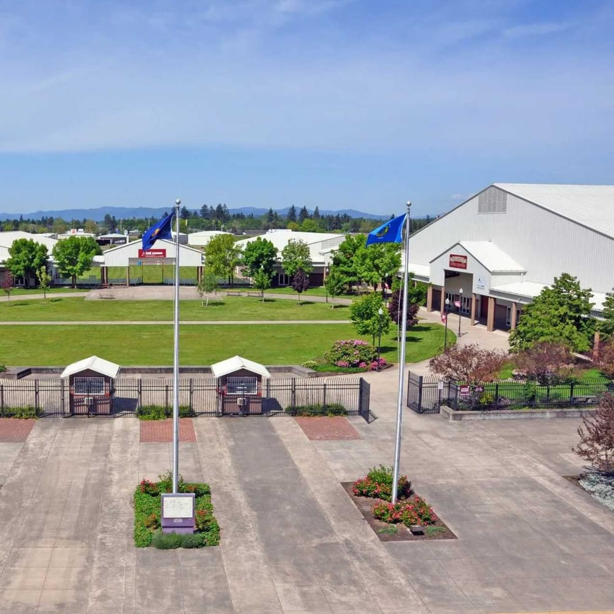
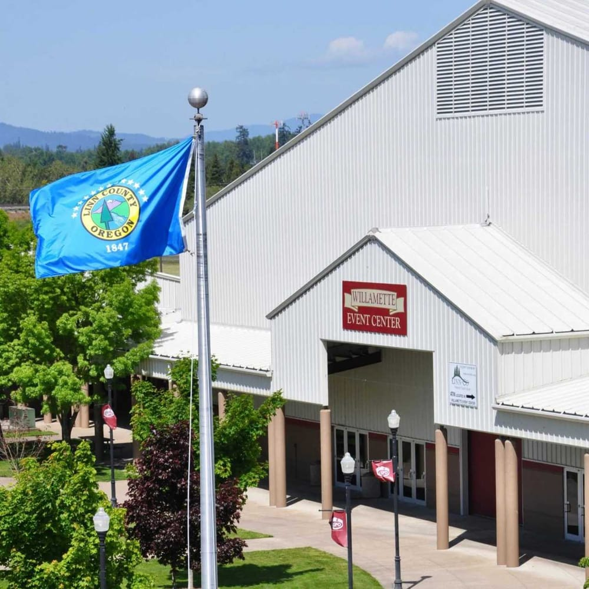
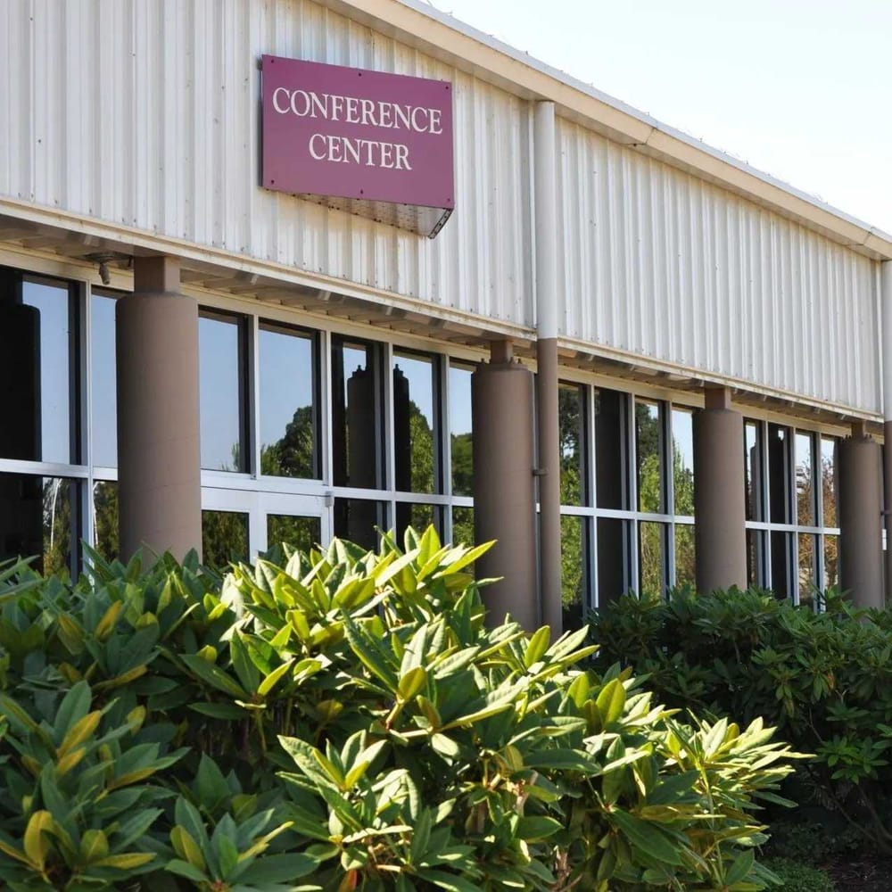

# Venue

Most of the festival is at the **Linn County Fair & Expo Center**, 3700 Knox
Butte Rd SE, Albany, OR ([map](https://www.google.com/maps/search/?api=1&query=Linn+County+Fair+and+Expo+Center+3700+Knox+Butte+Rd+SE+Albany+OR)).
Two programs are in nearby hotels instead.

## Where each program dances

| Program | Room | Building |
| --- | --- | --- |
| Mainstream Extended | Willamette South (Hall A) | Willamette Event Center |
| Plus | Willamette North (Hall C) | Willamette Event Center |
| Relaxed Mainstream | Conference Room 1 | Conference Center |
| Round Dancing | Conference Room 3/4 | Conference Center |
| Advanced (A1, A2, C1) | Holiday Inn Express | Off-site |
| Clogging | Comfort Suites | Off-site |

Vendors are in the Willamette Event Center with Mainstream and Plus.

## Off-site programs

Both hotels are next door to the Expo Center, on Opal Court.

- **Advanced (A1, A2, C1):** Holiday Inn Express, 105 Opal Ct NE, Albany
  ([map](https://www.google.com/maps/search/?api=1&query=Holiday+Inn+Express+105+Opal+Ct+NE+Albany+OR))
- **Clogging:** Comfort Suites, 100 Opal Ct NE, Albany
  ([map](https://www.google.com/maps/search/?api=1&query=Comfort+Suites+100+Opal+Ct+NE+Albany+OR))

## Venue map

North is up: Knox Butte Rd runs along the top, and the hotels are just
north of the fairgrounds.

## The buildings

Expo Center entrance

Willamette Event Center — Mainstream, Plus, and vendors

Conference Center — Relaxed Mainstream and round dancing
