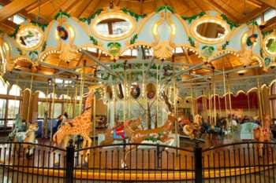
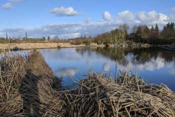
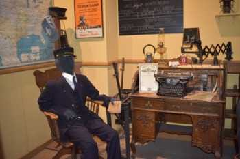
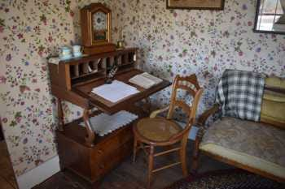
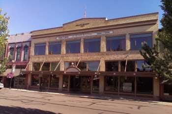
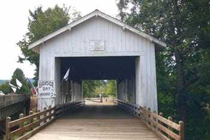

# Things to Do

A few places around Albany worth a visit between dances.

## Albany Historic Carousel & Museum

A menagerie-style carousel on a 1909 Dentzel Carousel Corporation mechanism,
with hand-carved animals from a seven-foot giraffe to dragons, lions, tigers
and bears. The museum shows antique carousel horses donated by the Dentzel
family, and the studio where new animals are still carved and painted.
[albanycarousel.com](https://albanycarousel.com)

## Talking Water Gardens

An engineered wetland that cleans and cools treated water before it returns
to the Willamette River, with over two miles of wheelchair-accessible trails
and more than 100 species of birds. 577 Waverly Dr NE.

## Albany Regional Museum

Photographs, artifacts and displays on Albany's history, in an 1887 building
in the Historic Downtown District. Plan on at least an hour.
[armuseum.com](https://www.armuseum.com)

## Monteith House

One of Oregon's most authentically restored pioneer-era homes, built in 1849
by the brothers who founded Albany. Docent-led tours on Saturdays.
[monteithhouse.org](https://www.monteithhouse.org)

## Historic districts

Four historic districts and over 700 historic buildings. Walk downtown for
shopping and a bite to eat, or see the historic homes of the Monteith and
Hackleman districts.

## Covered bridges

Linn County has eight covered bridges, a good country-road driving tour. The
1932 Crawfordsville Bridge, about 30 miles from the Expo Center, is at 38323
Crawfordsville Dr, Sweet Home. See Linn County's pages for the
[Crawfordsville](https://www.co.linn.or.us/roads/page/crawfordsville-covered-bridge),
[Gilkey](https://www.co.linn.or.us/roads/page/gilkey-covered-bridge),
[Hannah](https://www.co.linn.or.us/roads/page/hannah-covered-bridge),
[Hoffman](https://www.co.linn.or.us/roads/page/hoffman-covered-bridge),
[Jordan](https://www.co.linn.or.us/roads/page/jordan-covered-bridge-relocated),
[Larwood](https://www.co.linn.or.us/roads/page/larwood-covered-bridge),
[Shimanek](https://www.co.linn.or.us/roads/page/shimanek-covered-bridge) and
[Weddle](https://www.co.linn.or.us/roads/page/weddle-covered-bridge-relocated)
bridges.
